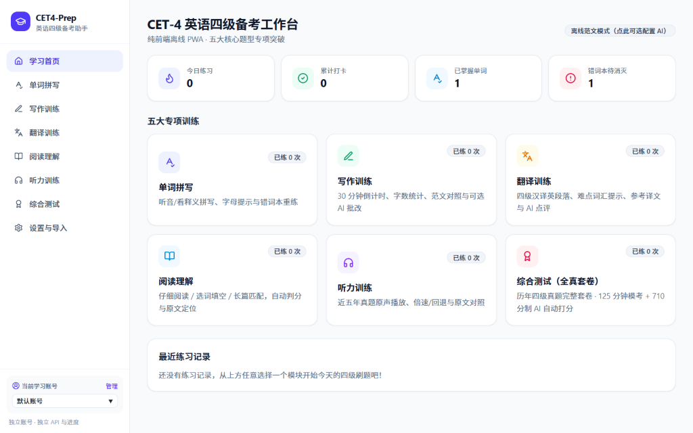
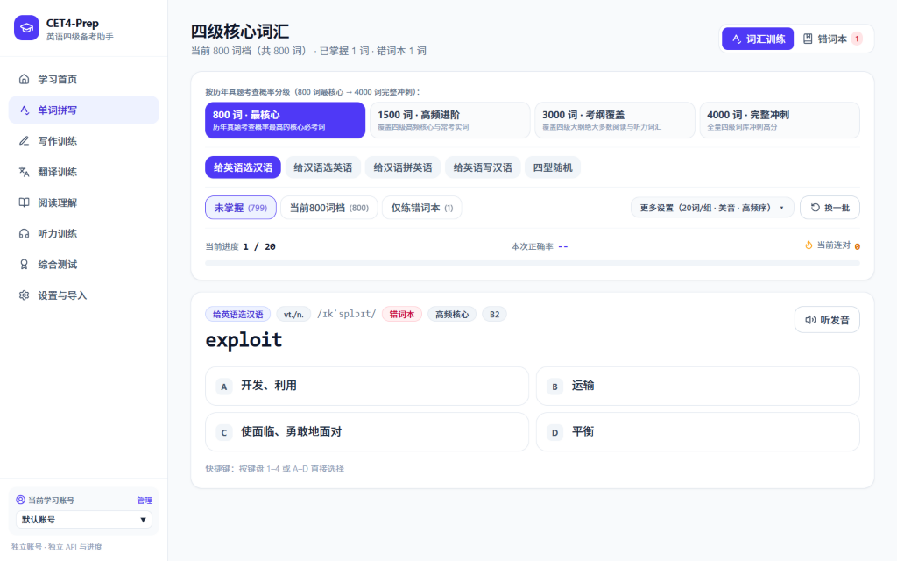
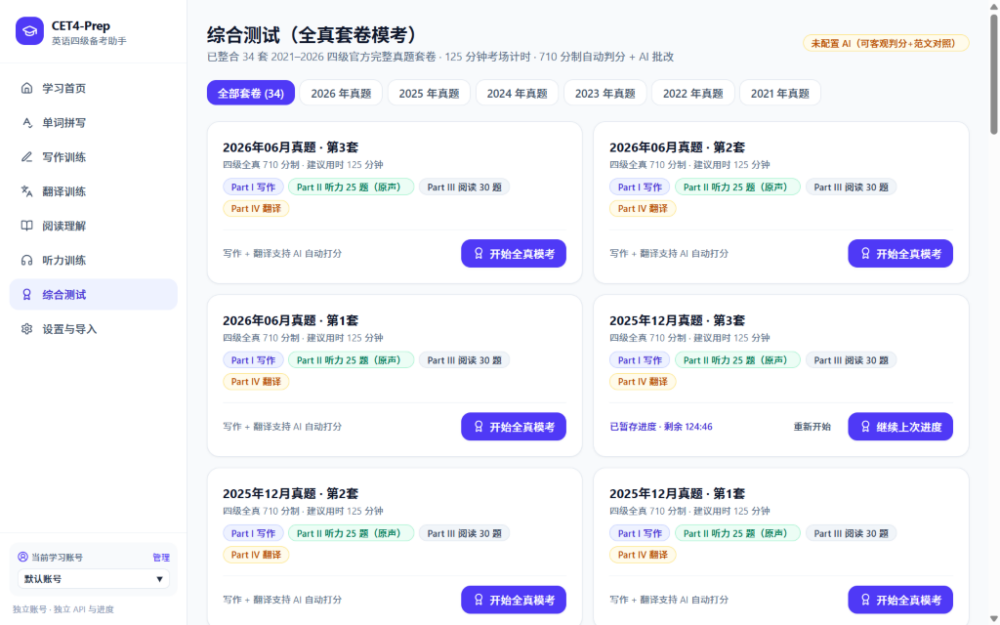

<div align="center">


# CET4-Prep · 英语四级（CET-4）全能备考助手

**零广告 · 零后端 · 4,000 核心词四档分级 · 2021–2026 官方真题 · AI 一键批改 · 手机单文件离线刷题**

[](https://zliu3250-arch.github.io/CET4-Prep1/)
[](https://github.com/zliu3250-arch/CET4-Prep1/releases/tag/v1.0.0)
[](./LICENSE)
[](https://react.dev/)

</div>

---

## 界面预览

> 支持 **桌面端 + 375px 手机竖屏** 全页面自适应，点开即刷题，零干扰、零弹窗、零广告。

### 学习工作台（桌面端 & 手机端双端自适应）

| 桌面端学习首页（1280×800） | 手机端竖屏适配（375×812） |
| :---: | :---: |
|  |  |

### 核心专项刷题与全真模考

| 4,000 词四档分级 · 答对自动下一题 / 答错入错词本重做 | 2021–2026 官方完整真题套卷 · 710 分制 + AI 自动批改 |
| :---: | :---: |
|  |  |

---

## 核心亮点

- **单词四档分级 + 极速刷词**：按历年真题考查概率分为 `800 最核心 / 1500 高频 / 3000 考纲 / 4000 冲刺` 四档；提供「给英语选汉语 / 给汉语选英语 / 给汉语拼英语 / 给英语写汉语 / 四型随机」纯词汇题型；**答对自动下一题，答错立刻存入错词本并继续作答直到做对**。
- **写作 & 翻译（离线范文 + 可选 AI 批改）**：默认展示 **2026年06月最新官方真题**，顶部下拉键按时间倒序一键换题；开始输入自动启动倒计时并本地存草稿；配好任意 OpenAI 兼容 API（DeepSeek / OpenAI / 各类中转）即可一键 AI 打分与逐句润色。
- **阅读理解 & 听力训练**：覆盖选词填空、长篇匹配、仔细阅读（135 篇）及听力完整套卷（23 套）；移动端支持「看原文 / 做题」一键切换、未交卷进度自动暂存与防误触确认；听力支持导入本地 MP3/WAV 倍速播放或浏览器离线逐句朗读（TTS）。
- **综合测试（710 分制全真套卷模考）**：整合 2021–2026年06月官方完整真题套卷，125 分钟考场倒计时、中途自动断点暂存与恢复、交卷秒出客观分并并发 AI 批改写作与翻译。
- **多账号完全本地隔离**：支持新建/切换多个学习账号，每个账号拥有独立的 API Key、错词本、草稿与模考记录；任何新设备首次打开均为 100% 全新空白账号，数据绝不上传第三方服务器。
- **一键打包手机单文件离线版**：通过 `npm run build:singlefile` 可直接生成单个约 5 MB 的独立 `.html` 文件，发到手机浏览器即可离线刷题。

---

## 快速开始

### 方式一：直接在线使用 / 下载手机单文件（推荐）
- **免下载在线版**：直接访问 [https://zliu3250-arch.github.io/CET4-Prep1/](https://zliu3250-arch.github.io/CET4-Prep1/)
- **手机离线单文件版**：前往 [Releases v1.0.0](https://github.com/zliu3250-arch/CET4-Prep1/releases/tag/v1.0.0) 下载 `CET4-Prep-singlefile-v1.0.0.html`，发到手机用 Chrome / Safari / Edge / 夸克等浏览器打开即可离线使用。

### 方式二：本地开发与自行构建
```bash
# 安装依赖并启动开发服务器
npm install
npm run dev

# 构建标准 Web / PWA 版并本地预览（含听力 HLS 代理）
npm run build
node scripts/serve-dist.mjs

# 一键打包手机单文件离线版（输出 CET4-Prep-单文件版.html）
npm run build:singlefile
```

---

## 技术栈

- **框架**：React 19 + TypeScript 5（严格模式）+ Vite 6
- **样式与图标**：Tailwind CSS v4 + Lucide React
- **本地存储**：`localStorage`（按账号隔离进度与配置）+ `IndexedDB`（自定义题库与本地音频）
- **音频与离线**：`hls.js` + Web Speech API + `vite-plugin-pwa`

---

## 隐私与开源协议

- **隐私安全**：本应用为纯前端项目，你的 API Key、学习进度、错词本、作文草稿与本地音频**仅存储在你自己的浏览器本地**，不会上传到任何作者服务器。
- **开源协议**：本项目源代码基于 [MIT License](./LICENSE) 开源，仅供个人学习与英语备考交流使用。
