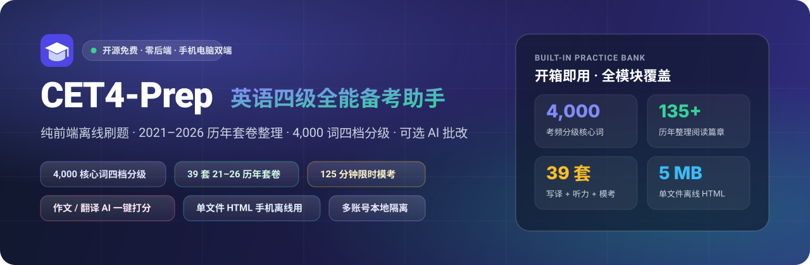
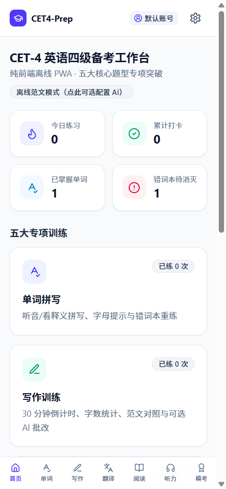

<div align="center">



# CET4-Prep · 英语四级（CET-4）全能备考助手

**零广告 · 零后端 · 4,000 核心词四档分级 · 2021–2026 官方真题 · AI 一键批改 · 手机单文件离线刷题**

[](https://zliu3250-arch.github.io/CET4-Prep1/)
[](https://github.com/zliu3250-arch/CET4-Prep1/releases/tag/v1.0.0)
[](./LICENSE)
[](https://react.dev/)

</div>

---

## 界面预览

> 支持 **桌面端 + 375px 手机竖屏** 全页面自适应，点开即刷题，零干扰、零弹窗、零广告。

### 学习工作台（桌面端 & 手机端双端自适应）

| 桌面端学习首页（1280×800） | 手机端竖屏适配（375×812） |
| :---: | :---: |
|  |  |

### 核心专项刷题与全真模考

| 4,000 词四档分级 · 答对自动下一题 / 答错入错词本重做 | 2021–2026 官方完整真题套卷 · 710 分制 + AI 自动批改 |
| :---: | :---: |
|  |  |

---

## 核心亮点

- **单词四档分级 + 极速刷词**：按历年真题考查概率分为 `800 最核心 / 1500 高频 / 3000 考纲 / 4000 冲刺` 四档；提供「给英语选汉语 / 给汉语选英语 / 给汉语拼英语 / 给英语写汉语 / 四型随机」纯词汇题型；**答对自动下一题，答错立刻存入错词本并继续作答直到做对**。
- **写作 & 翻译（离线范文 + 可选 AI 批改）**：默认展示 **2026年06月最新官方真题**，顶部下拉键按时间倒序一键换题；开始输入自动启动倒计时并本地存草稿；配好任意 OpenAI 兼容 API（DeepSeek / OpenAI / 各类中转）即可一键 AI 打分与逐句润色。
- **阅读理解 & 听力训练**：覆盖选词填空、长篇匹配、仔细阅读（135 篇）及听力完整套卷（23 套）；移动端支持「看原文 / 做题」一键切换、未交卷进度自动暂存与防误触确认；听力支持导入本地 MP3/WAV 倍速播放或浏览器离线逐句朗读（TTS）。
- **综合测试（710 分制全真套卷模考）**：整合 2021–2026年06月官方完整真题套卷，125 分钟考场倒计时、中途自动断点暂存与恢复、交卷秒出客观分并并发 AI 批改写作与翻译。
- **多账号完全本地隔离**：支持新建/切换多个学习账号，每个账号拥有独立的 API Key、错词本、草稿与模考记录；任何新设备首次打开均为 100% 全新空白账号，数据绝不上传第三方服务器。
- **一键打包手机单文件离线版**：通过 `npm run build:singlefile` 可直接生成单个约 5 MB 的独立 `.html` 文件，发到手机浏览器即可离线刷题。

---

## 快速开始

### 方式一：直接在线使用 / 下载手机单文件（推荐）
- **免下载在线版**：直接访问 [https://zliu3250-arch.github.io/CET4-Prep1/](https://zliu3250-arch.github.io/CET4-Prep1/)
- **手机离线单文件版**：前往 [Releases v1.0.0](https://github.com/zliu3250-arch/CET4-Prep1/releases/tag/v1.0.0) 下载 `CET4-Prep-singlefile-v1.0.0.html`，发到手机用 Chrome / Safari / Edge / 夸克等浏览器打开即可离线使用。

### 方式二：本地开发与自行构建
```bash
# 安装依赖并启动开发服务器
npm install
npm run dev

# 构建标准 Web / PWA 版并本地预览（含听力 HLS 代理）
npm run build
node scripts/serve-dist.mjs

# 一键打包手机单文件离线版（输出 CET4-Prep-单文件版.html）
npm run build:singlefile
```

---

## 开发者复用：替换词库/题库并打包单文件离线版

本项目内置词库与练习数据解耦在 `public/data/` 目录下，并通过 [`scripts/build-singlefile.mjs`](./scripts/build-singlefile.mjs)（150 行左右）以 Vite IIFE 模式内联到 `<script id="cet4-embedded-banks" type="application/json">` 中。**替换符合现有数据结构的文件即可复用这套单文件离线构建流程**（若要完整迁移到其他考试，除替换对应题库外，还需按需调整题型、界面文案与评分/组卷逻辑）：

1. **查看并替换 `public/data/` 下的 JSON 数据文件**（顶层均须为非空数组）：
   - `public/data/vocab-cet4.json`（词汇数组；注意：前端按数组前 `800 / 1500 / 3000 / 4000` 条切分累积词档，而非按 `tags` 分级；选择题干扰项来自同词库其他不同词义词条，因此自定义词库建议至少包含 4 条不同词义，否则选择题选项会少于 4 项）
   - `public/data/reading-2021-2025.json`、`listening-2021-2025.json`、`writing-2021-2025.json`、`translation-2021-2025.json`
2. **最小词库 JSON 格式示例（`public/data/vocab-cet4.json`）**：
   `VocabItem` 必填字段仅 4 项（`id` 须唯一、`word`、`pos`、`meaning`）；`phonetic` 与 `tags` 为可选项：
   ```json
   [
     {
       "id": "custom-1",
       "word": "physician",
       "pos": "n.",
       "meaning": "医师、内科医生"
     }
   ]
   ```
3. **本地验证并打包独立单文件 HTML**：
   ```bash
   npm run typecheck
   npm run build:singlefile
   # 构建脚本会自动执行 IIFE 单块打包、vocab-cet4 必填字段/唯一 id 校验、JSON 内联转义
   # 并在写入文件前执行特定 sk-... 格式正则检查（非通用全服务商密钥扫描器）
   # 输出根目录独立离线文件：CET4-Prep-单文件版.html（当前约 5.18 MiB / 5.43 MB）
   ```

---

## 技术栈

- **框架**：React 19 + TypeScript 5（严格模式）+ Vite 6
- **样式与图标**：Tailwind CSS v4 + Lucide React
- **本地存储**：`localStorage`（按账号隔离进度与配置）+ `IndexedDB`（自定义题库与本地音频）
- **音频与离线**：`hls.js` + Web Speech API + `vite-plugin-pwa`

---

## 隐私、离线边界与开源协议

- **不自建应用后端 & AI 数据流向（BYOK）**：在线版采用 GitHub Pages 静态托管，无作者自建应用后端。学习进度、错词本、草稿与 API Key 明文保存在用户浏览器 `localStorage` 中（源码未对 Key 做额外加密，请勿在公共设备上保存个人 Key）。当你点击「加载模型列表」「测试连接」或「AI 批改」时，浏览器会**直接向你配置的第三方 OpenAI 兼容端点发送请求**（包括 API Key，以及写作的题目标题/要求/字数限制/你的作文，或翻译的中文原文/参考译文/你的译文），可能产生的 API 费用由用户自行承担。不配置 Key 时，离线范文与自评独立可用。
- **单文件离线边界**：单文件 HTML 内置应用代码与文本题库，但**真题 HLS 原音频不会随单文件离线**；离线刷听力时默认使用浏览器 Web Speech API 逐句朗读（语音是否可用、是否支持离线取决于设备浏览器与系统语音包），也可自行导入本地 MP3/WAV（存入 IndexedDB，播放时临时生成 Object URL 并在卸载时撤销，不持久化 `blob:` URL）。125 分钟套卷限时在未配置 AI 时仅对客观题自动计分。不同手机浏览器对本地 `file://` 的存储持久化行为存在差异。
- **开源协议与数据来源边界**：本项目**源代码**基于 [MIT License](./LICENSE) 开源；`public/data/` 下的词库、练习文本与音频索引由 [`scripts/fetch-cet4-data.mjs`](./scripts/fetch-cet4-data.mjs) 汇总自公开第三方仓库（具体上游地址见该脚本），**不包含在 MIT 授权范围内，亦非考试机构官方授权**。如需二次分发内置题库或音频，请自行核实上游仓库许可与原内容版权授权。

---

## 路线图与支持作者

- [x] 4,000 核心词按历年真题考频分四档（800 / 1500 / 3000 / 4000）
- [x] 2021–2026年06月 39 套官方真题 + 710 分制全真套卷模考
- [x] 写作 & 翻译 AI 自动批改 + 多账号本地隔离
- [x] 手机单文件离线版 HTML 一键打包
- [ ] **CET-6（英语六级）题库与词库支持**（规划中）

> 如果 **CET4-Prep** 帮到了你的四级备考，欢迎点击页面右上角的 **⭐ Star** 支持一下，也欢迎分享给正在备考的同学！你的每一颗 Star 都是持续更新六级版与最新真题的最大动力。

